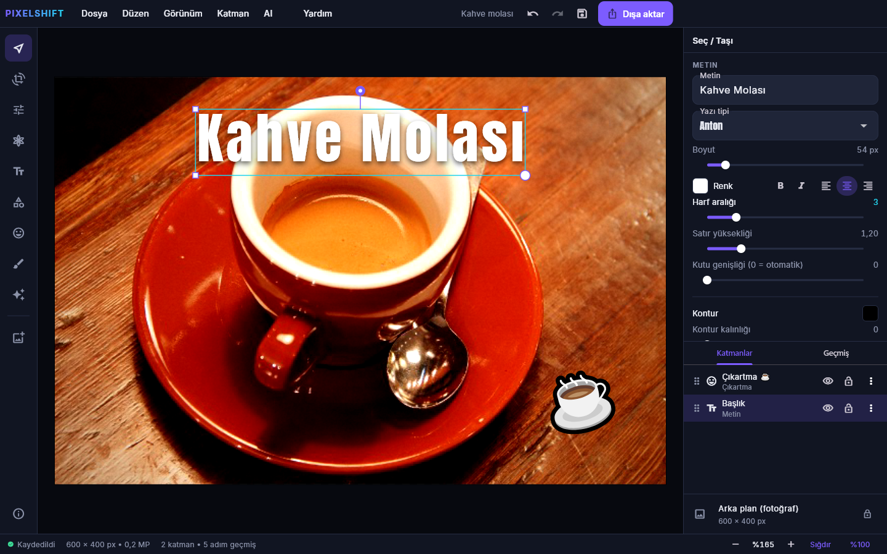
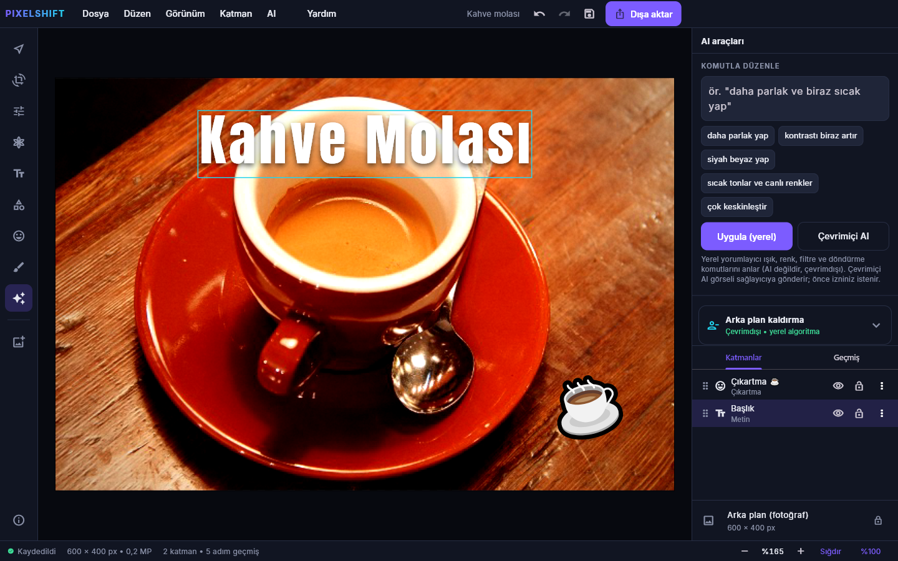
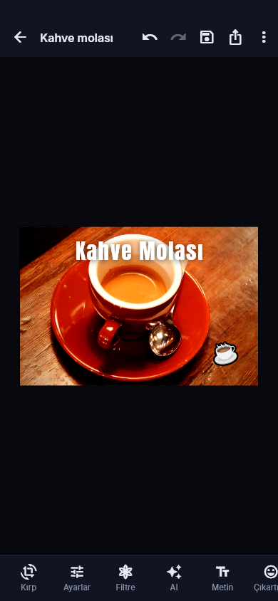
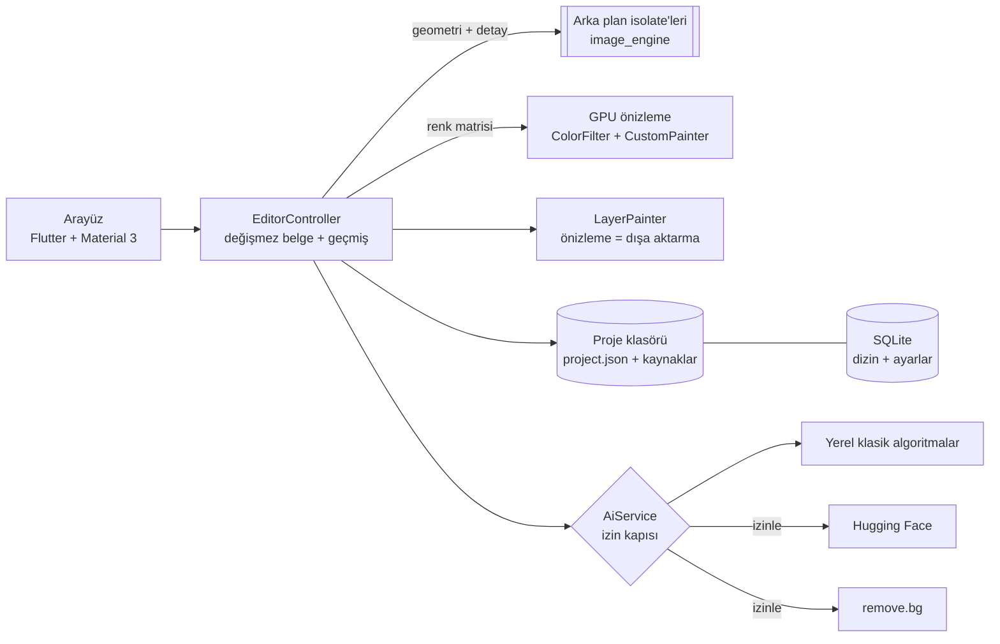

<div align="center">


# PIXELSHIFT

**Türkçe, koyu temalı, çevrimdışı çalışan profesyonel fotoğraf düzenleyici**
Windows 10/11 · Android · Flutter

[](https://github.com/furkantr1923/pixelshift/actions/workflows/build.yml)


*PIXELSHIFT — Furkan tarafından geliştirildi.*

</div>

---

PIXELSHIFT, yeni başlayanların temel işlemleri saniyeler içinde yapabildiği, gerektiğinde katman, maske, kolaj, şablon ve toplu işlem gibi profesyonel araçlara ulaşılabilen bir fotoğraf düzenleyicidir. Hesap gerektirmez, fotoğraflar cihazdan çıkmaz; yalnızca kullanıcı açıkça izin verdiğinde seçilen AI sağlayıcısına gönderilir.

## Ekran görüntüleri

| Masaüstü düzenleyici | AI araçları | Telefon |
|---|---|---|
|  |  |  |

> Görüntüler CI'da derlenen gerçek Windows uygulamasından `pixelshift.exe --screenshots=<klasör>` komutuyla otomatik üretilir.

## Özellikler

### Temel düzenleme (çevrimdışı)
- Bilgisayardan / telefondan / galeriden fotoğraf açma (JPG, PNG, WEBP, BMP, TIFF, GIF, PSD, SVG, RAW)
- Yakınlaştırma (fare tekerleği, iki parmak), kaydırma, ekrana sığdırma, %100 görünüm
- Kırpma (serbest ve 1:1, 4:5, 16:9… oranları), 90° döndürme, yatay/dikey çevirme, serbest düzleştirme
- Pozlama, parlaklık, kontrast, gölgeler, açık tonlar, doygunluk, sıcaklık, ton, keskinlik, netlik, bulanıklık, vinyet, gren
- Gri tonlama ve 18 hazır filtre (yoğunluk ayarlı)
- Çok adımlı geri al / yinele ve tıklanabilir düzenleme geçmişi
- JPG, PNG, WEBP (kayıpsız + kayıplı), BMP, TIFF dışa aktarma; kalite ve çözünürlük seçimi
- Uygulamanın kendi klasöründe proje kaydı, son projeler, yeniden adlandırma, kaydedilmemiş değişiklik uyarısı

### Profesyonel araçlar
- **Katmanlar:** metin, görsel, şekil ve çıkartma katmanları; sıralama, görünürlük, kilit, opaklık, 16 karışım modu
- **Maskeleme:** fırça/silgi, kenar yumuşatma, maskeyi göster/gizle, maskeyi devre dışı bırak
- **Metin ve tasarım:** 8 gömülü yazı tipi (Türkçe karakter destekli), kontur, gölge, arka plan kutusu, hizalama
- **Şekiller ve çıkartmalar:** 10 vektör şekil, renk geçişi, emoji çıkartmaları
- **Şablonlar:** afiş, sosyal medya, kapak ve kart şablonları
- **Kolaj:** 10 hazır düzen, boşluk, köşe yuvarlama, çerçeve, kutu içinde kaydırma/yakınlaştırma
- **Toplu işlem:** format dönüştürme, boyutlandırma, filtre, otomatik iyileştirme, ilerleme ve hata raporu

### AI ve akıllı araçlar
| Görev | Yerel (çevrimdışı, klasik algoritma) | Çevrimiçi (izinle) |
|---|---|---|
| Arka plan kaldırma | Düz/tek renkli arka planlar | Hugging Face, remove.bg |
| Arka plan değiştirme | Renk, geçiş veya görsel | — |
| Nesne silme | Çok ölçekli difüzyon doldurma | — |
| Fotoğraf iyileştirme | Seviye, renk dengesi, netlik | — |
| Çözünürlük yükseltme | 2×/4× bikübik + keskinleştirme | Hugging Face (Swin2SR) |
| Portre / cilt rötuşu | Ten bölgesi, kenar koruyan yumuşatma | — |
| Restorasyon | Gürültü/toz azaltma, solmuş renk | — |
| Sanatsal stil | Yağlı boya, karakalem, çizgi film, pop art | Hugging Face (instruct-pix2pix) |
| Metin komutu | Türkçe komut yorumlayıcı ("daha parlak ve sıcak yap") | Hugging Face (instruct-pix2pix) |

> "Yerel" araçlar **yapay zekâ değildir**; arayüzde de böyle etiketlenir. Ayrıntı: [docs/AI_SAGLAYICILARI.md](docs/AI_SAGLAYICILARI.md)

## Gizlilik

- Fotoğraflar ve projeler yalnızca cihazda saklanır; hesap ve zorunlu bulut yoktur.
- Çevrimiçi işlemden **önce her seferinde** sağlayıcı, adres, gönderilecek veri, saklama bilgisi ve ücret/sınır gösterilir. İzin verilmezse **hiçbir istek gönderilmez** (testle doğrulanır).
- API anahtarları kaynak koda gömülmez (testle taranır); kullanıcı Ayarlar'dan girer.
- Dışa aktarılan dosyalarda EXIF/konum bilgisi bulunmaz.

## İndirme

[Releases](https://github.com/furkantr1923/pixelshift/releases) sayfasından:

| Dosya | Açıklama |
|---|---|
| `PIXELSHIFT-Setup-1.0.0.exe` | Windows kurulum paketi |
| `PIXELSHIFT-Portable-1.0.0-win-x64.zip` | Kurulumsuz, taşınabilir sürüm |
| `PIXELSHIFT-1.0.0*.apk` | Android (5.0+) |

Kurulum ayrıntıları: [docs/KURULUM.md](docs/KURULUM.md) · Kullanım: [docs/KULLANIM_KILAVUZU.md](docs/KULLANIM_KILAVUZU.md)

## Mimari



Önemli tasarım kararları ([docs/MIMARI.md](docs/MIMARI.md)):
- **Tahribatsız düzenleme:** orijinal dosya hiç değişmez; belge yalnızca parametreleri tutar. Geri al/yinele, değişmez belge anlık görüntüleriyle bellek dostu çalışır.
- **Önizleme ≠ çıktı çözünürlüğü:** ekranda küçültülmüş kopya, dışa aktarmada tam çözünürlük işlenir; büyük JPEG'ler DCT ölçekli çözülür.
- **Aynı kod, aynı sonuç:** renk ayarları tek bir 5×4 matrise indirgenir (ekranda GPU, çıktıda Dart); katmanlar her iki yolda aynı `LayerPainter` ile çizilir.
- **Kendi WebP kodlayıcısı:** saf Dart VP8L (kayıpsız) kodlayıcı; Windows ve Android'de yerel kütüphane gerektirmez.
- **Arayüz donmaz:** tüm ağır işler isolate'lerde; büyük dışa aktarmalarda katmanlar 2048 px karolar hâlinde GPU'da birleştirilir.

## Kaynaktan derleme

```bash
git clone https://github.com/furkantr1923/pixelshift.git
cd pixelshift
flutter pub get
dart run tool/setup.dart        # android/ ve windows/ klasörlerini üretir, ayarları uygular
flutter test                    # birim + arayüz testleri
flutter build windows --release
flutter build apk --release
```

Gereksinimler: Flutter 3.27.x, Windows için Visual Studio 2022 (C++ masaüstü), Android için Android SDK + Java 17.

## Testler

| Katman | Kapsam |
|---|---|
| Birim (`test/`) | Kodlayıcılar (WebP birebir doğrulama dahil), geometri, renk, proje deposu (gerçek SQLite), AI adaptörleri (sahte sunucu), izin kapısı, komut yorumlayıcı, klasik algoritmalar, toplu işlem |
| Arayüz (`test/widget_test.dart`) | Masaüstü ve telefon boyutunda ana ekran/düzenleyici, taşma kontrolü, gömülü anahtar ve İngilizce metin taraması |
| Uçtan uca (`integration_test/`) | Windows ve Android 14 emülatöründe içe aktar → düzenle → katman → yerel AI → kaydet → yeniden aç → dışa aktar |
| Kendi kendini sınama | Derlenmiş `pixelshift.exe --self-test` ile gerçek ikili dosyada kodlayıcılar, büyük görsel, proje sistemi, GPU birleştirme, gizlilik |

Son test raporu: [docs/TEST_RAPORU.md](docs/TEST_RAPORU.md)

## Bilinen sınırlamalar

- **PSD:** katmanlar ayrı açılmaz, birleştirilmiş görüntü düzenlenir.
- **RAW:** ham sensör verisi işlenmez; kameranın gömülü JPEG önizlemesi kullanılır.
- **GIF:** animasyon korunmaz (ilk kare). **HEIC/AVIF** desteklenmez (anlaşılır hata verilir).
- **SVG:** piksel görüntüye dönüştürülerek düzenlenir.
- Yerel arka plan kaldırma yalnızca düz arka planlarda iyi sonuç verir; karmaşık sahneler için çevrimiçi sağlayıcı gerekir.
- Çevrimiçi sağlayıcılar geliştirme ortamında gerçek servisle değil, sahte sunucuyla test edilmiştir (ağ kısıtı); ücretsiz kotalar sağlayıcıya bağlıdır.
- Emoji çıkartmaları platformun emoji yazı tipiyle çizilir; Windows ve Android'de görünüm farklıdır.
- Windows kurulum paketi kod imzalama sertifikası içermez (SmartScreen uyarısı görülebilir).
- Windows ve Android arasında otomatik senkronizasyon yoktur.

## Lisans

Kaynak kod MIT lisanslıdır ([LICENSE](LICENSE)). Gömülü yazı tipleri SIL Open Font License 1.1, örnek fotoğraflar CC0 / kamu malıdır ([assets/demo/KAYNAK.txt](assets/demo/KAYNAK.txt)).

---

<div align="center"><b>PIXELSHIFT — Furkan tarafından geliştirildi.</b></div>
